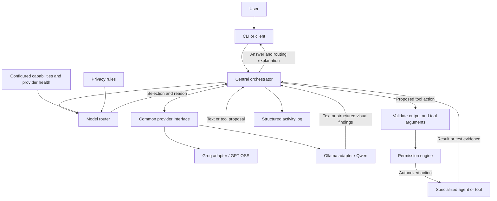

# FRIDAY Architecture

## Product requirements

**Status — required design, pending review before Milestone 1.** FRIDAY must select a model automatically for each task and coordinate model handoffs when the task needs both text and visual reasoning. One central orchestrator owns the request from intake through tool execution and verification. The router, provider adapters and specialized agents are components within FRIDAY.

Users can override automatic selection and see the chosen model, provider and reason for each step. A compatible fallback must be visible. If no available model satisfies the request and privacy rules, FRIDAY must explain which requirement prevents it from proceeding.

## Milestone 0 baseline

The existing Typer CLI provides one-shot chat and a REPL. Both use a configuration-selected provider through a shared OpenAI-compatible text chat interface with streaming, bounded timeouts and retries. Settings come from `config.yaml` and local environment overrides. Activity goes to a configured JSONL log. Existing tests exercise the foundation offline. The diagram and contracts below describe the required design for review.

## Architecture diagram

## Initial model strategy

| Model | Provider and configured model ID | Input | Primary responsibilities |
| --- | --- | --- | --- |
| GPT-OSS 20B | Groq API · `openai/gpt-oss-20b` | Text | Coding, debugging, reasoning, planning, research synthesis, tool calling and agent orchestration under the central orchestrator |
| Qwen 3.5 9B | Local Ollama · `qwen3.5:9b` | Text and images | Screenshots, diagrams, visual analysis, TradingView charts and multimodal tasks |

These are the two initial model entries. Model IDs, endpoints, paths and request settings belong in configuration. Backend adapters resolve credentials from the environment. Keep local secrets out of source control.

## Provider contract

The orchestrator submits a typed request through a common interface. Each model entry declares accepted input modalities and support for generation, streaming, tool calls and structured output. The router reads these capabilities, and the adapter checks the request again before dispatch. An image-bearing payload must never reach GPT-OSS.

Separate Groq and Ollama adapters translate messages, images, stream events, tool proposals and structured responses into provider-specific formats where supported. Both expose health checks, apply bounded timeouts and retries, and report errors and usage through the common interface. Providers return proposals to the orchestrator. Only FRIDAY's permission-checked execution path can invoke a tool.

## Routing specification

For each step, the router identifies user intent, task class, complexity, input modality and required capabilities. It filters candidates by those requirements, configured privacy rules and provider availability. Clear cases use deterministic policies. Only ambiguous cases use a lightweight classifier.

| Task | Initial policy |
| --- | --- |
| Coding, debugging, planning or general reasoning | Select GPT-OSS for text reasoning. |
| Research synthesis | Select GPT-OSS and obtain evidence through authorized research tools. |
| Screenshot, diagram, image or visual chart analysis | Select Qwen with the image input. |
| Screenshot-based coding diagnosis | Select Qwen for visual findings, then GPT-OSS for diagnosis using permitted text context. |
| Other mixed multimodal tasks | Use a sequential handoff when one step produces findings another step needs. |

A manual override selects a model for a compatible step and is subject to the same checks. Explain an incompatible override before dispatch. On provider failure, re-evaluate availability, capabilities and privacy for the affected step. Disclose any fallback and its reason. If Qwen is unavailable for image analysis, report that the visual step cannot run. Never send the image to the text-only provider.

## Screenshot debugging workflow

1. The orchestrator asks local Qwen to interpret the VS Code screenshot.
2. Qwen returns structured visual findings such as visible error text, file names and uncertain readings. The orchestrator validates the findings before handoff.
3. The orchestrator checks whether privacy rules allow sending those findings and the relevant repository excerpts to Groq. Derived text can still contain private data. Only permitted text enters the GPT-OSS request.
4. GPT-OSS investigates the issue and proposes a change.
5. FRIDAY validates the proposed action and arguments against the tool's Pydantic schema. The permission engine checks the action and its risk level.
6. The coding agent applies the authorized change.
7. The test runner verifies the result and the orchestrator reports the outcome.

## Security and observability

Every tool has a Pydantic input schema, tests and a risk level of `READ`, `WRITE`, `DESTRUCTIVE` or `NEVER`. File and command tools operate within configured workspaces. Writes and destructive actions require authorization under the applicable policy. A model choice, override or fallback cannot grant permission. Autonomous financial trades remain prohibited.

Log the selected model and provider, routing reason, latency, errors and token usage for each step, including handoffs and fallbacks. Mark usage unavailable when a provider omits it. Keep credentials out of clients and logs, and enforce privacy rules before every external dispatch. Deterministic work such as scheduling and financial calculations stays in ordinary Python.

## Required acceptance tests

Use fake providers to observe calls, payloads, outcomes and logs offline.

| Case | Expected evidence |
| --- | --- |
| 1. Text coding task | Automatic routing selects Groq GPT-OSS 20B. |
| 2. Screenshot analysis | Only Ollama Qwen receives the screenshot. |
| 3. Screenshot debugging | Qwen runs first. GPT-OSS receives validated findings and permitted repository text. |
| 4. Unsupported image input | An image request, including a forced GPT-OSS override, produces zero image-bearing calls to Groq. |
| 5. Provider failure | A compatible available fallback is disclosed. When none qualifies, the user receives a clear error. |
| 6. Manual override | A compatible explicit choice is honored and reported with its provider and reason. |
| 7. Safety controls | Denied actions and malformed tool proposals never execute. Restricted data stays local, including during handoff or fallback. |
| 8. Decision logging | Each step records model, provider, reason, latency, error status and token usage or its availability. |

The milestone sequence and review gate are tracked in [PROGRESS.md](PROGRESS.md).

## Implemented privacy boundary

Both CLI chat paths emit typed operational events through `friday.logging`. The schema admits request metadata, safe outcome codes and optional tool/approval metadata. The logger validates identifier-shaped labels and applies the shared redactor to configured model names, tool names and provider request identifiers. Token counts are scoped to each request. Debugging adds the streaming flag. The shared provider client classifies failures using exception types, HTTP status and a UUID-form request header. The CLI displays a safe diagnostic.

Conversation persistence lives in `friday.memory.conversations`. The existing in-memory REPL context works with persistence disabled. When enabled, a transaction stores each completed turn as a single Fernet-authenticated ciphertext in SQLite. The configured history key acts as a local bearer credential. A derived owner identifier scopes listing, reading and deleting. Each ciphertext binds the conversation ID to its contents. SQLite retains operational indexes, timestamps and pseudonymous ownership identifiers in cleartext. The application purges expired turns on database access and supports explicit deletion even after capture is disabled. The current trust boundary is the local OS user and their private key, filesystem permissions and backups.
