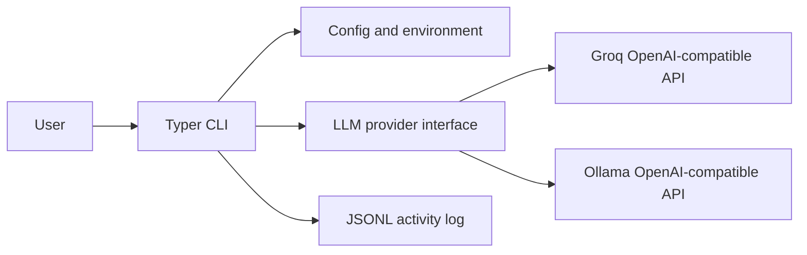

# FRIDAY Architecture

FRIDAY is a personal assistant built around one orchestrator and specialized modules. The initial milestone establishes a text-first chat path that can use either Groq or a local Ollama server through the same OpenAI-compatible API shape. Later modules for tools, memory, research, planning, coding, documents, finance, voice, and computer use plug into that core.

## Initial request path

## Initial components

- `config.yaml` selects the provider, model, endpoint, timeout, and retry policy.
- `.env` supplies credentials and local overrides; it is never committed.
- `friday.llm` owns the provider interface and HTTP implementation. CLI code does not depend on a specific vendor.
- `friday.cli` exposes one-shot chat and an interactive REPL.
- Structured logs are written to the configured log path.
- Tests use a fake provider so they do not call a network service.

## Safety and growth

Tool execution will be centralized in the agent loop. Each tool will have a Pydantic input schema and an explicit risk level. Permission decisions and tool activity will be audited. `NEVER` actions cannot be enabled by configuration; financial trades are never performed. File and command tools will be restricted to configured workspaces, and writes or destructive actions will require the permission policy specified for their risk level.

Safety, tests, and evaluations are part of the early milestones rather than a final retrofit. New modules should keep deterministic work (such as scheduling and financial metrics) in ordinary Python, with the language model interpreting requests and explaining results.

## Milestone 0 acceptance

`friday chat "hello"` and the interactive REPL use the same chat interface. Switching between Groq and Ollama requires configuration changes only. Provider failures surface as a clear FRIDAY error, with bounded timeouts and retries.

## Implemented privacy boundary

Both CLI chat paths emit typed operational events through `friday.logging`. The schema admits request metadata, safe outcome codes and optional tool/approval metadata. The logger validates identifier-shaped labels and applies the shared redactor to configured model names, tool names and provider request identifiers. Token counts are scoped to each request. Debugging adds the streaming flag. The shared provider client classifies failures using exception types, HTTP status and a UUID-form request header. The CLI displays a safe diagnostic.

Conversation persistence lives in `friday.memory.conversations`. The existing in-memory REPL context works with persistence disabled. When enabled, a transaction stores each completed turn as a single Fernet-authenticated ciphertext in SQLite. The configured history key acts as a local bearer credential. A derived owner identifier scopes listing, reading and deleting. Each ciphertext binds the conversation ID to its contents. SQLite retains operational indexes, timestamps and pseudonymous ownership identifiers in cleartext. The application purges expired turns on database access and supports explicit deletion even after capture is disabled. The current trust boundary is the local OS user and their private key, filesystem permissions and backups.
